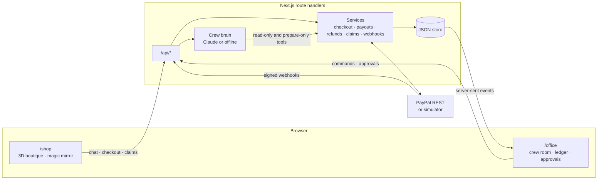

# CrewOS

**A robot crew for one-person shops.** Built for the PayPal AI Hackathon 2026.

Maryam runs **Mira Eyewear**, a small eyewear boutique in Lisbon, on her own. CrewOS gives her four robots that
sell, keep the books, pay suppliers and look after customers, all through PayPal. They talk to her in plain language,
and money only moves when she says so.

| Robot     | Job           | What it does                                                                                      |
| --------- | ------------- | ------------------------------------------------------------------------------------------------- |
| **Lumi**  | Stylist       | Greets customers in a 3D boutique, reads their face shape in an AR magic mirror and sells frames. |
| **Penny** | Bookkeeper    | Books every PayPal capture with its real fee, keeps the ledger and writes the daily briefing.     |
| **Otto**  | Payables      | Prepares supplier payouts and sends them through PayPal Payouts once Maryam approves.             |
| **Kai**   | Customer care | Looks at a photo of a damaged pair, applies the care policy and refunds through PayPal.           |

The app has three pages:

- **`/`**: the story and the crew.
- **`/shop`**: the boutique where customers meet Lumi, try frames on and pay with PayPal.
- **`/office`**: Maryam's back office: the crew room, a live ledger, approvals, a daily briefing and a voice console.

## Run it in two minutes

You need Node.js 20.9 or newer.

```bash
npm install
npm run dev
```

Open [http://localhost:3000](http://localhost:3000).

**No keys are needed.** Without PayPal keys a built-in simulator runs the same payment flows. Without a Claude key
the crew uses a rule-based offline brain. Badges on every page show which mode is live. To use the real PayPal
sandbox and Claude, see [Connect PayPal and Claude](#connect-paypal-and-claude).

## A walkthrough

Open `/shop` and `/office` side by side with sound on. Voice works in Chrome, Edge and Safari; typing works
everywhere.

1. **Meet Lumi.** In the boutique, click _Enter the boutique_. Ask her something like _"I need sunglasses for the
   beach"_ by voice or text. She answers out loud and lifts the frames she picks off the wall.
2. **Try frames on.** Open the magic mirror. With _Start the camera_, an on-device face mesh reads your face shape
   and overlays the frames on your face. The video never leaves the browser. No camera? Use the mannequin, or tell
   Lumi your face shape.
3. **Pay with PayPal.** Add a pair to the bag and check out. Without keys, a simulated approval window stands in
   for PayPal's. In the back office Penny books the sale, coins rain onto her desk and the ledger and KPIs update in
   real time.
4. **Pay a supplier.** In the office console, say or type _"Pay Lens Lab"_. Otto prepares the payout and it waits in
   the approvals tray. Say _"approve"_ or click _Approve_ and the payout goes out through PayPal.
5. **Settle a claim.** Back in the boutique, open the care desk, enter the order number and attach a photo of a
   damaged pair, or pick _Use a sample photo_ for a scratched lens. Kai describes the damage, the care policy
   decides, and a refund up to the limit ($25 by default) is paid at once. Bigger refunds wait for Maryam.
6. **Ask the crew.** Try _"How are we doing this week?"_, _"Show this week's refunds"_ or open the daily briefing.
   Use _Reset demo_ in the office header to start the week over.

## How AI is used

The rule throughout is: **AI proposes, code decides, the owner approves.**

| Where                  | Claude                                                                        | Plain code                                                                    |
| ---------------------- | ----------------------------------------------------------------------------- | ----------------------------------------------------------------------------- |
| Lumi, the stylist      | Holds the conversation and picks frames from the catalog (structured output). | MediaPipe face landmarks and geometry classify the face shape on the device.  |
| The crew console       | Runs a tool loop over seven narrow tools to answer Maryam and prepare work.   | Every tool only reads data or creates a pending request. None can move money. |
| Kai, customer care     | Looks at the claim photo and reports damage type, severity and confidence.    | The care policy turns that report into decline, photo request or refund.      |
| Penny, the daily brief | Writes the briefing from figures the server has already computed.             | KPIs, fees and totals are calculated in code, never by the model.             |

Details:

- Calls use the official Anthropic SDK with the model in `ANTHROPIC_MODEL` (default `claude-opus-5-5`).
- Structured outputs are validated with Zod schemas.
- The crew console uses the SDK's tool runner, capped at six iterations.
- System prompts are cached.
- If Claude is unavailable or declines a request, each feature falls back to its offline stand-in, so the demo never
  dead-ends.
- The crew's tools are `business_snapshot`, `list_supplier_bills`, `prepare_supplier_payout`, `find_orders`,
  `prepare_refund`, `show_ledger` and `recent_ledger`.

## PayPal integration

| API           | Used for                                                                                                               |
| ------------- | ---------------------------------------------------------------------------------------------------------------------- |
| **Orders v2** | Checkout through the PayPal JS SDK button. The server prices the order from the catalog, then creates and captures it. |
| **Payouts**   | Supplier payments after the owner approves. Each batch has a stable `sender_batch_id`, so a retry can never pay twice. |
| **Refunds**   | Full or partial refunds on a capture, paid instantly under the policy limit or after approval.                         |
| **Webhooks**  | Signature-verified events reconcile captures, refunds, denials, reversals and payouts. Events are de-duplicated by id. |

Every create, capture and refund call sends a `PayPal-Request-Id`, so a retried request is idempotent. Penny books the
fee PayPal actually charged, read from the capture's `seller_receivable_breakdown`.

## The AG Grid ledger

Penny's ledger in the back office is built on AG Grid Community (`ag-grid-react`). It loads only the modules it uses.

- **Live rows.** Entries arrive over server-sent events. `getRowId` keeps each row stable, so a new sale, payout or
  refund slides in, and a cell flashes when PayPal confirms it.
- **The crew drives the grid.** When Maryam asks "Show this week's refunds", Claude calls the `show_ledger` tool. The
  grid then applies that view as an external filter.
- **The owner's search** is AG Grid's quick filter across orders, people and PayPal IDs.
- **A pinned totals row** follows whatever is visible: amount, PayPal fees and net.
- **CSV export** hands the visible rows to an accountant.

## Safety model

- **No AI on the money path.** Claude can look things up and prepare requests. Payouts and large refunds are only
  executed by an explicit owner decision.
- **Refunds only go back to the original payment.** Every refund is made against the order's PayPal capture, so a
  claim can never send money to anyone but the buyer.
- **Voice approval is matched by plain code** in the owner's browser (`approvalIntent` in
  `src/lib/client/office.ts`), never by the model.
- **The server is the source of truth.** Prices come from the catalog and limits from the care policy, never from the
  browser. Every request body is validated with Zod.
- **Webhooks are verified** with PayPal's signature verification API before anything is trusted.
- **Endpoints that cost or move money are rate limited** per client.
- **Secrets stay on the server.** The browser only receives the public PayPal client ID and which modes are live.
- **Camera frames never leave the device.** Lumi only receives the derived face shape and frame size.
- **The back office is the owner's alone.** Nothing in the boutique links to it. This demo leaves it open so anyone
  can try it; a real shop would put it behind the owner's sign-in.

## Connect PayPal and Claude

Copy `.env.example` to `.env.local` and fill in what you have. Each part is optional and switches on independently.

### PayPal sandbox

1. Sign in at [developer.paypal.com](https://developer.paypal.com) and open **Apps & Credentials** in **Sandbox**
   mode.
2. Create an app (type _Merchant_). Copy its **Client ID** and **Secret** into `PAYPAL_CLIENT_ID` and
   `PAYPAL_CLIENT_SECRET`.
3. In the app's features, make sure **Payouts** is enabled.
4. Under **Testing Tools → Sandbox Accounts**, copy the email of the default _Personal_ account into
   `PAYPAL_PAYOUT_RECEIVER`. Every supplier payout is sent there, so you can watch it arrive. Use the same personal
   account to log in at checkout.
5. Webhooks need a public HTTPS URL, so add them after deploying. In the app, add a webhook for
   `https://<your-host>/api/paypal/webhook` with these events:
   - `PAYMENT.CAPTURE.COMPLETED`, `PAYMENT.CAPTURE.REFUNDED`, `PAYMENT.CAPTURE.DENIED`, `PAYMENT.CAPTURE.REVERSED`
   - `PAYMENT.PAYOUTSBATCH.*` and `PAYMENT.PAYOUTS-ITEM.*`

   Copy the **Webhook ID** into `PAYPAL_WEBHOOK_ID`.

Records keep the rail they were created on. A seeded or simulated order is still refunded by the simulator after you
add keys, while new orders go through the sandbox.

### Claude

Create a key at [console.anthropic.com](https://console.anthropic.com) and set `ANTHROPIC_API_KEY`. Consider setting
a monthly spend limit on the key.

### Environment variables

| Variable                 | Required | Description                                                        |
| ------------------------ | -------- | ------------------------------------------------------------------ |
| `PAYPAL_CLIENT_ID`       | No       | Sandbox app client ID. Without it, the PayPal simulator is used.   |
| `PAYPAL_CLIENT_SECRET`   | No       | Sandbox app secret.                                                |
| `PAYPAL_WEBHOOK_ID`      | No       | Enables the webhook endpoint and its signature checks.             |
| `PAYPAL_PAYOUT_RECEIVER` | No       | Sandbox personal account that receives every supplier payout.      |
| `ANTHROPIC_API_KEY`      | No       | Claude API key. Without it, the offline brain is used.             |
| `ANTHROPIC_MODEL`        | No       | Claude model id. Defaults to `claude-opus-5-5`.                    |
| `AUTO_REFUND_LIMIT_USD`  | No       | Instant refund ceiling in whole dollars, 0 to 500. Defaults to 25. |
| `DATA_DIR`               | No       | Folder for the JSON data file. Defaults to `./.data`.              |

Keys are read at request time, so a deployment picks up new values after a restart, without a rebuild.

## Deploy

CrewOS is a standard Next.js server app and runs anywhere Node.js does. On [Render](https://render.com):

1. Create a **Web Service** from the repository.
2. Build command: `npm ci && npm run build`. Start command: `npm start`.
3. Add the environment variables above.
4. Add the PayPal webhook for `https://<your-service>.onrender.com/api/paypal/webhook` and set `PAYPAL_WEBHOOK_ID`.

Demo data lives in a JSON file. On hosts without a persistent disk it starts as a fresh demo week after every
deploy or restart. Attach a disk and point `DATA_DIR` at it to keep data between deploys. Run a single instance: the
store, the live event stream and the rate limiter all live in one process.

## Architecture



```
src/
  app/                 Pages (/, /shop, /office) and route handlers under app/api
  components/
    landing/           Landing page
    shop/              Boutique UI and its 3D scene (Lumi, frame wall, vanity mirror)
    mirror/            Magic mirror: camera, face mesh and try-on overlay
    office/            Back office UI, the crew room scene and the AG Grid ledger
    three/             Shared 3D pieces: robots, glasses, materials, floor
    ui/                Small shared UI parts
  hooks/               Speech recognition, live feed, shared clock
  lib/
    domain/            Pure, shared logic: types, catalog, money, care policy, KPIs
    client/            Browser state (zustand), API client, speech synthesis
    server/            Store, env, rate limiting
      ai/              Claude wrapper, crew tools, stylist, claims vision, briefing
      paypal/          Sandbox REST client and the simulator behind one gateway
      services/        Checkout, payouts, refunds, claims, approvals, webhooks
```

### API routes

| Method | Route                                    | Purpose                                                |
| ------ | ---------------------------------------- | ------------------------------------------------------ |
| GET    | `/api/config`                            | Which modes are live, and the public PayPal client ID. |
| POST   | `/api/stylist`                           | One turn of the conversation with Lumi.                |
| POST   | `/api/checkout/orders`                   | Create a PayPal order priced on the server.            |
| POST   | `/api/checkout/orders/{orderId}/capture` | Capture an approved order and book the sale.           |
| POST   | `/api/claims`                            | Submit a damage claim with a photo.                    |
| GET    | `/api/office/state`                      | Everything the back office renders.                    |
| GET    | `/api/office/events`                     | Live updates as server-sent events.                    |
| POST   | `/api/office/command`                    | A typed or spoken command for the crew.                |
| POST   | `/api/office/approvals/{id}`             | Approve or decline a pending payout or refund.         |
| POST   | `/api/office/briefing`                   | Penny's daily briefing.                                |
| POST   | `/api/office/reset`                      | Restore the demo week.                                 |
| POST   | `/api/paypal/webhook`                    | PayPal webhook receiver.                               |

## Scripts

| Command                | What it does                                          |
| ---------------------- | ----------------------------------------------------- |
| `npm run dev`          | Start the development server.                         |
| `npm run build`        | Build for production.                                 |
| `npm start`            | Serve the production build.                           |
| `npm run lint`         | Run ESLint.                                           |
| `npm run typecheck`    | Generate route types and run the TypeScript compiler. |
| `npm run format`       | Format the source with Prettier.                      |
| `npm run format:check` | Check formatting without writing.                     |

`npm install` also copies MediaPipe's WebAssembly runtime into `public/mediapipe`, so the mirror loads it from the
app's own origin. The face landmarker model is fetched from Google's MediaPipe model storage.

## Built with

Next.js 16 and React 19, React Three Fiber and drei, MediaPipe Tasks Vision, AG Grid, Tailwind CSS 4, zustand, Zod,
the Anthropic SDK and the PayPal REST APIs and JS SDK.

## Notes

- Mira Eyewear is a fictional shop. Everything runs on sandbox or simulated money.
- The demo starts with a seeded week of sales, bills and claims. If nobody has used it for three days, it starts a
  fresh week so "today" is never empty.

## License

[MIT](LICENSE)
